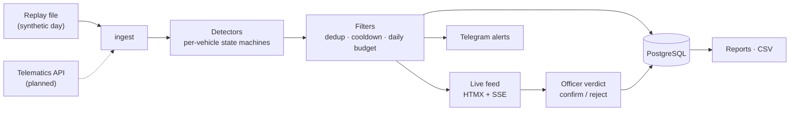

# BusCore — safety monitoring for a bus fleet

Backend MVP for a transit operator's safety team: vehicle telemetry goes through violation detectors into a live event feed, where an officer confirms or rejects each event in seconds. Built solo with AI agents (Claude Code), spec-first and test-first: from design spec to reviewed MVP between 13 and 14 August 2026.

> **Status:** MVP running on synthetic replay data — Plan 1 of 3. Computer-vision detectors (Plan 2) and live telematics and video clips (Plan 3) are designed in the spec but not built yet.

## What it does

- **Telemetry detectors** for 6 violation types: speeding, harsh braking, harsh acceleration, route deviation, skipped mandatory stop, long idling. Each detector is a per-vehicle state machine; thresholds live in the database (`rule_configs`) and change without a redeploy.
- **Event pipeline:** candidate → deduplication, per-vehicle cooldown and a daily alert budget → published → officer verdict (`confirmed` or `rejected` with a reason).
- **Live feed:** server-rendered with Jinja2 and HTMX, updated over Server-Sent Events, with day statistics and hotkeys `1` / `2` for verdicts.
- **Notifications:** Telegram alerts by role, quiet hours, a single summary instead of a flood once the daily budget is exceeded, and a watchdog when no signals arrive for 10 minutes.
- **Reports** with CSV export, and three roles: admin, security officer, read-only manager.
- **Operations:** Docker Compose, Alembic migrations, data retention, backup and restore runbook.

## Architecture



One async FastAPI service and PostgreSQL; the replay source plays a recorded day as if it were live, so development, demos and tests never wait for access to a real fleet.

## Run it

```bash
docker compose up -d --build
make demo
```

Then open <http://localhost:8000/feed>. Demo login: `sb` / `sb123` — local demo data only, seeded by `scripts/seed_demo.py`; change these accounts for any real deployment. Other targets: `make test`, `make backup`, `make restore`. The operator runbook (in Russian) is in [README-RUNBOOK.md](README-RUNBOOK.md).

## Tests

46 tests with pytest and pytest-asyncio against PostgreSQL, run in GitHub Actions on every push:

- **golden tests for each detector** — "find exactly these violations, and nothing else";
- **an end-to-end synthetic day** — a replayed day with 5 planted violations must produce exactly those 5 events, each attributed to a driver;
- auth and roles, the feed, reports, maintenance jobs.

## How it was built

The history of this repository is a record of AI-assisted, spec-driven development:

1. **Design spec** — [docs/superpowers/specs](docs/superpowers/specs/2026-08-13-bus-ai-monitoring-design.md): goals, decisions with rationale, event catalog, data model, risks.
2. **TDD plan** — [docs/superpowers/plans](docs/superpowers/plans/2026-08-13-bus-ai-monitoring-plan1-telemetry-feed.md): 15 tasks, each starting with a failing test.
3. **Implementation** — executed task by task by Claude Code subagents; every commit carries a `Co-Authored-By` trailer.
4. **Final review** — a separate pass found and fixed real bugs: the shift day was computed outside the fleet's time zone (it surfaced after midnight), and a late data backfill reset the daily budget counter. Background tasks got supervision, and the end-to-end test was tightened.

## Tech

Python 3.12 · FastAPI · SQLAlchemy 2 (async) · PostgreSQL 17 · Alembic · Jinja2 · HTMX · Server-Sent Events · Shapely · Docker Compose · GitHub Actions · Telegram Bot API

---

Design documents in `docs/` are written in Russian. The code is shared for portfolio review; all rights reserved.
